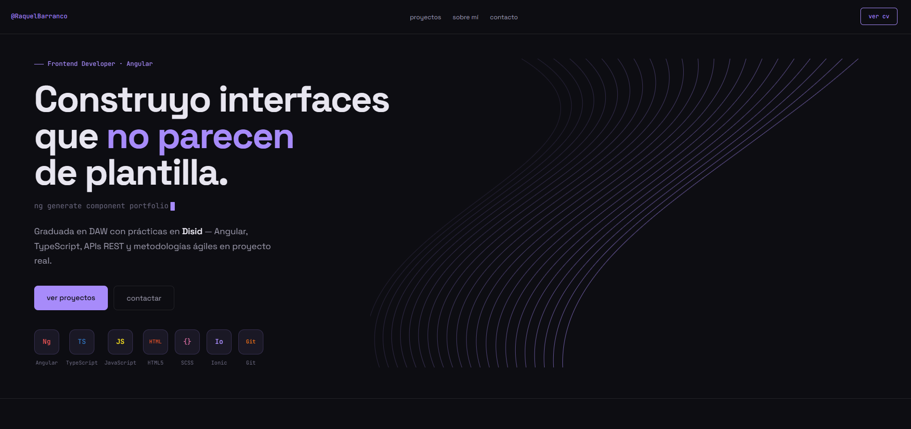

# Portfolio — Raquel Barranco

Portfolio personal desarrollado desde cero con **Angular 20** y **SCSS**, con un diseño propio pensado para no parecer una plantilla. Presenta mi perfil como desarrolladora frontend, mis proyectos y una vía de contacto directa.

🔗 **[Ver portfolio en vivo](https://portfolioraquel-indol.vercel.app)**



---

## Características

- **Diseño propio** — identidad visual personalizada (paleta violeta sobre fondo oscuro, tipografía y animaciones a medida), sin plantillas
- **Animación en Canvas** — fondo de líneas animadas en el hero y en el detalle de proyecto, con un componente reutilizable
- **Proyectos con detalle** — cada proyecto tiene su propia página con descripción, funcionalidades y enlaces al repositorio y la demo
- **Carta de recomendación** — testimonio real de las prácticas, con opción de leer la carta completa
- **Formulario de contacto** — con validación mediante Reactive Forms e integración con EmailJS
- **Descarga de CV** — en PDF, directamente desde la web
- **Diseño responsive** — adaptado a móvil, tablet y escritorio, con menú hamburguesa
- **Despliegue continuo** — cada push a `main` se despliega automáticamente en Vercel

---

## Tecnologías

| Tecnología | Uso |
|---|---|
| Angular 20 | Framework principal, con componentes standalone |
| TypeScript | Tipado estático en todo el proyecto |
| SCSS | Estilos con variables centralizadas y arquitectura por componente |
| RxJS | Gestión del flujo del formulario de contacto |
| Canvas API | Animaciones de fondo |
| EmailJS | Envío del formulario de contacto sin backend |
| Vercel | Despliegue y hosting |

---

## Decisiones técnicas

**Componentes standalone sin NgModules.** Todo el proyecto usa la API moderna de Angular (standalone components, `inject()`, signals), que es el estándar actual del framework y reduce el boilerplate.

**Lazy loading de rutas.** La página principal y el detalle de cada proyecto se cargan de forma diferida con `loadComponent`, reduciendo el tamaño del bundle inicial.

**Un componente de animación reutilizable.** La animación de fondo en Canvas vive en un único componente compartido que se usa tanto en el hero como en el detalle de proyecto, en lugar de duplicar la lógica.

**Datos de proyectos centralizados en un servicio.** La información de los proyectos se gestiona desde un `ProjectsService`, de modo que añadir o actualizar un proyecto es un solo cambio en un sitio.

---

## Instalación

Requisitos previos: Node.js 20 o superior y npm.

```bash
# Clonar el repositorio
git clone https://github.com/rakelBarranco/dev.portfolio.git
cd dev.portfolio

# Instalar dependencias
npm install

# Arrancar el proyecto
npm start
```

La aplicación estará disponible en `http://localhost:4200`.

> El formulario de contacto usa EmailJS. Las credenciales se gestionan en `src/environments/environment.ts`.

---

## Estructura del proyecto

```
src/
├── app/
│   ├── core/
│   │   ├── models/          # Interfaces y tipos compartidos
│   │   └── services/        # ProjectsService
│   ├── features/            # Secciones: hero, about, projects, contact, home
│   └── shared/
│       └── components/      # Nav y componente de animación reutilizable
└── environments/            # Configuración (EmailJS)
```

---

## Autora

**Raquel Barranco** — Desarrolladora Frontend

[Weather App](https://weather-app-raquel.vercel.app) · [LinkedIn](https://www.linkedin.com/in/raquel-barrval-70a9361b5) · [GitHub](https://github.com/rakelBarranco)
